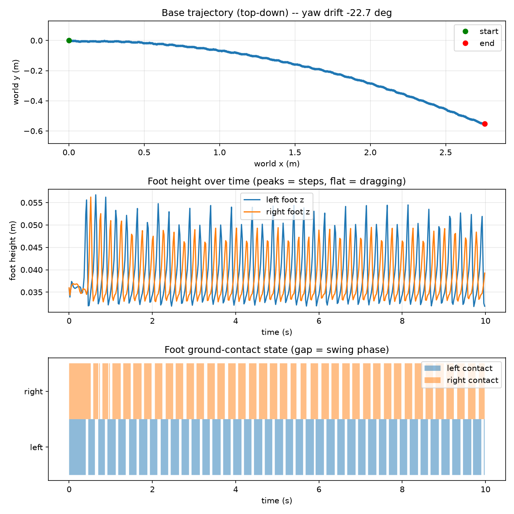

# PPO Locomotion Gait Evaluation — Unitree G1

## Objective

Evaluate the canonical PPO locomotion policy for the Unitree G1 in MuJoCo, focusing on stability, forward velocity, and foot movement. Document observed gait limitations and propose three reward-function changes for future experiments.

## Evaluation setup

- **Policy:** EXP-0026 (`best_checkpoint_2M.zip`)
- **Configuration:** `config/exp0012_air_time.yaml`
- **Simulator:** MuJoCo
- **Independent diagnostic:** October 21, 2026; 10 seconds at commanded velocity `vx=0.3 m/s`, `vy=0.0 m/s`
- **Historical reference:** Repository's recorded 20-episode deterministic evaluation (seeds 1000–1019)

The historical numbers below are from existing project records. The 10-second diagnostic was run separately in GitHub Codespaces.

## Results

### Historical 20-episode evaluation

| Metric | Recorded result |
| --- | ---: |
| Falls | 0 / 20 |
| Mean episode duration | 20.0 s |
| Mean velocity error | 0.0361 m/s |
| Mean net displacement | 4.28 m |
| Mean reliable distance ratio | 0.918 |
| Mean absolute endpoint yaw drift, normalized to 10 s | 17.62 degrees |

### Independent 10-second gait diagnostic

| Metric | Measured result |
| --- | ---: |
| Commanded forward velocity | 0.30 m/s |
| Commanded lateral velocity | 0.00 m/s |
| Duration completed | 10.0 s, no termination |
| Yaw drift | -22.7 degrees |
| Net forward progress | 2.76 m |
| Maximum lateral deviation from initial heading | 0.55 m |
| Left-foot liftoffs | 39 |
| Right-foot liftoffs | 40 |
| Left foot airborne | 24% of time |
| Right foot airborne | 27% of time |
| Both feet grounded | 49% of time |
| Both feet airborne | 0% of time |
| Left-foot vertical-position range | 0.032–0.057 m |
| Right-foot vertical-position range | 0.033–0.056 m |



The full evaluation output is preserved in [`results/gait_evaluation/evaluation_results.json`](../results/gait_evaluation/evaluation_results.json). The diagnostic plot is preserved in [`results/gait_evaluation/gait_diagnostic.png`](../results/gait_evaluation/gait_diagnostic.png).

## Gait observations

### 1. Stability and heading

The robot completed the 10-second diagnostic without termination. This demonstrates upright stability for this particular commanded rollout. However, it accumulated **-22.7 degrees of yaw drift** and reached **0.55 m of lateral deviation** from its initial heading. The historical evaluation also records nonzero yaw drift. The policy can stay upright while failing to walk consistently straight.

**Assessment:** Basic simulated balance is successful in the tested conditions; directional stability remains a significant weakness.

### 2. Forward velocity

At a commanded speed of 0.30 m/s for 10 seconds, nominal commanded travel is 3.00 m. The diagnostic reports **2.76 m of forward progress**, equivalent to **0.276 m/s average progress** or **92% of nominal commanded travel**. This is a displacement-based comparison, not an instantaneous velocity-tracking-error measurement. The historical evaluation's mean velocity error was 0.0361 m/s.

The combination of substantial forward progress and yaw drift indicates that good local forward movement does not guarantee a straight world-frame path.

**Assessment:** Forward progress is reasonable, but unintended rotation and lateral deviation limit effective straight-line locomotion.

### 3. Foot movement

The diagnostic counted **39 left-foot and 40 right-foot liftoffs in 10 seconds**, with each foot airborne for only **24–27%** of the rollout. Both feet were grounded for **49%** of the time, with no detected double-flight phase. This suggests rapid, short-duration stepping.

The left-foot vertical position varied from 0.032 to 0.057 m and the right from 0.033 to 0.056 m (spans of about 2.5 cm and 2.3 cm). These are vertical-position spans, **not validated ground-relative swing clearances**. The plot and contact definitions should be inspected before making a stronger clearance claim.

Previous repository investigations describe wide leg abduction and occasional loaded-foot slip, but this specific terminal diagnostic does not directly measure either issue.

**Assessment:** The measured gait has unusually frequent, short swing events. Foot clearance and stance-contact quality deserve further quantitative evaluation.

## Proposed reward-function changes

### 1. Swing-foot clearance reward

**Motivation:** Frequent liftoffs and low airborne-time fractions suggest that the controller may be favoring short, rapid steps.

**Proposal:** During a valid swing phase and nonzero walking command, reward each foot for approaching a moderate *ground-relative* clearance target. One possible shaping term is:

```text
clearance_reward = weight * sum_over_feet(
    is_swing * exp(-((clearance - target_clearance) / tolerance)^2)
)
```

**Expected effect:** More distinct swing phases and less shuffling.

**Risk:** Too much weight could cause exaggerated foot lifting or unstable stepping. Tune against the existing checkpoint rather than choosing a large weight immediately.

### 2. Stance-foot slip penalty

**Motivation:** Earlier project investigations report intermittent loaded-foot sliding; the independent diagnostic has not yet quantified it.

**Proposal:** Penalize horizontal foot velocity only when the foot is in stable contact with the ground:

```text
slip_penalty = -weight * sum_over_feet(
    stable_contact * (foot_vx^2 + foot_vy^2)
)
```

**Expected effect:** More consistent support contacts and less unwanted sliding.

**Risk:** A large penalty, or contact detection that includes touchdown/liftoff, could suppress normal stepping. Measure stance-foot speed before concluding that this change helps.

### 3. Heading-stabilization refinement

**Motivation:** The independent straight-walking rollout accumulated -22.7 degrees of yaw drift.

**Proposal:** Refine the existing heading-related reward to penalize wrapped angular deviation from a desired heading during straight-walking commands:

```text
heading_penalty = -weight * wrapped_heading_error^2
```

The desired heading should follow commanded turns if turning is introduced; it should not always be fixed to the episode's initial orientation.

**Expected effect:** Reduced yaw drift and lateral deviation.

**Risk:** Overweighting this term may reduce forward motion or produce awkward compensatory movements.

## Suggested validation plan

Test the changes **one at a time**, warm-starting from EXP-0026 where supported. Keep a baseline policy unchanged and use identical seeds, commanded speeds, episode lengths, and physics settings. Compare:

| Candidate | Primary measurement | Guardrails |
| --- | --- | --- |
| Clearance shaping | Ground-relative swing clearance and swing duration | Falls, velocity error |
| Slip penalty | Horizontal foot speed during stable stance | Falls, forward progress |
| Heading refinement | Absolute yaw drift and lateral deviation | Falls, forward progress |

A higher reward alone is not evidence of better locomotion. Report actual gait metrics and note any tradeoffs.

## Reproduction

From the repository root, with dependencies installed:

```bash
python -m evaluation.evaluate \
  --model experiments/runs/exp0026_air_time_on_exp0023_long/best_checkpoint_2M.zip \
  --config config/exp0012_air_time.yaml \
  --episodes 20 > evaluation_results.json

python -m diagnostics.gait_diagnostic \
  --model experiments/runs/exp0026_air_time_on_exp0023_long/best_checkpoint_2M.zip \
  --config config/exp0012_air_time.yaml \
  --vx 0.3 --vy 0.0 --seconds 10 \
  --out gait_diagnostic.png
```

The checked-in artifacts were moved to `results/gait_evaluation/` after execution. The evaluation output was generated successfully, but its detailed contents have not been independently inspected for this report; the diagnostic measurements above are transcribed from the terminal output.

## Conclusion

The PPO policy maintains upright locomotion during the tested straight-walking rollout and makes substantial forward progress. Its most clearly demonstrated limitations are **heading drift (-22.7 degrees in 10 seconds)** and **rapid, short-duration foot swings (39–40 liftoffs per foot)**. The three proposed reward changes—swing-foot clearance shaping, stance-foot slip penalization, and heading stabilization—are hypotheses for follow-up experiments, **not improvements already implemented or validated**.

## Sources

- Repository README and recorded EXP-0026 evaluation summary
- `docs/FAILURE_ANALYSIS.md` (prior gait investigations)
- `config/exp0012_air_time.yaml`
- [Independent evaluation output](../results/gait_evaluation/evaluation_results.json)
- [Independent gait diagnostic plot](../results/gait_evaluation/gait_diagnostic.png)
